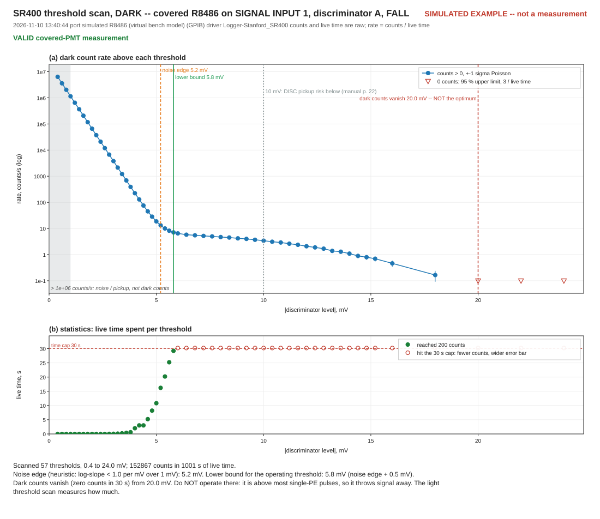
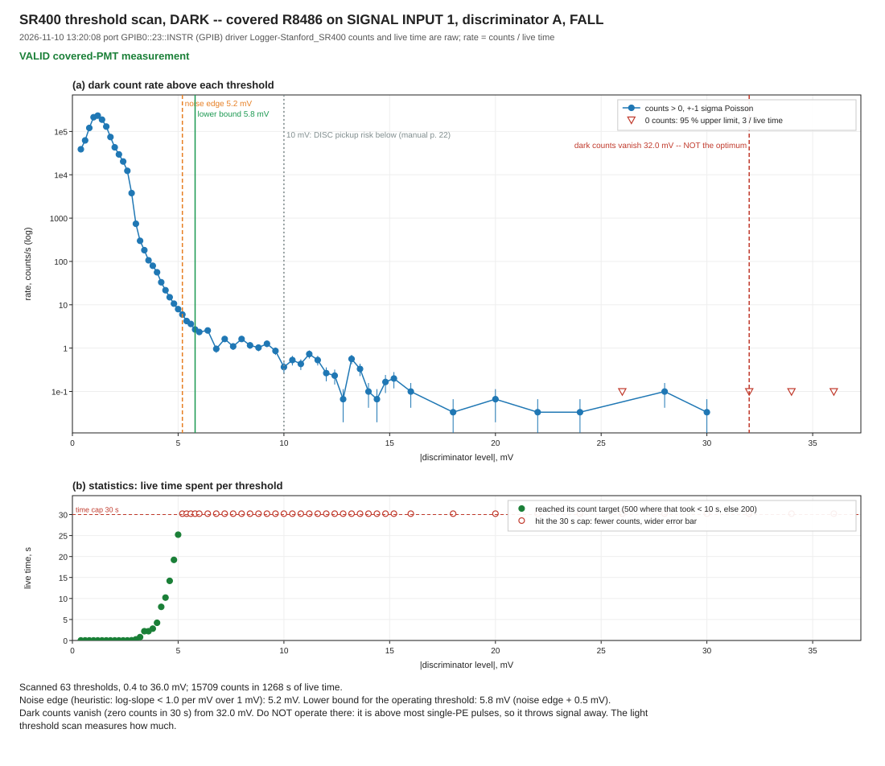
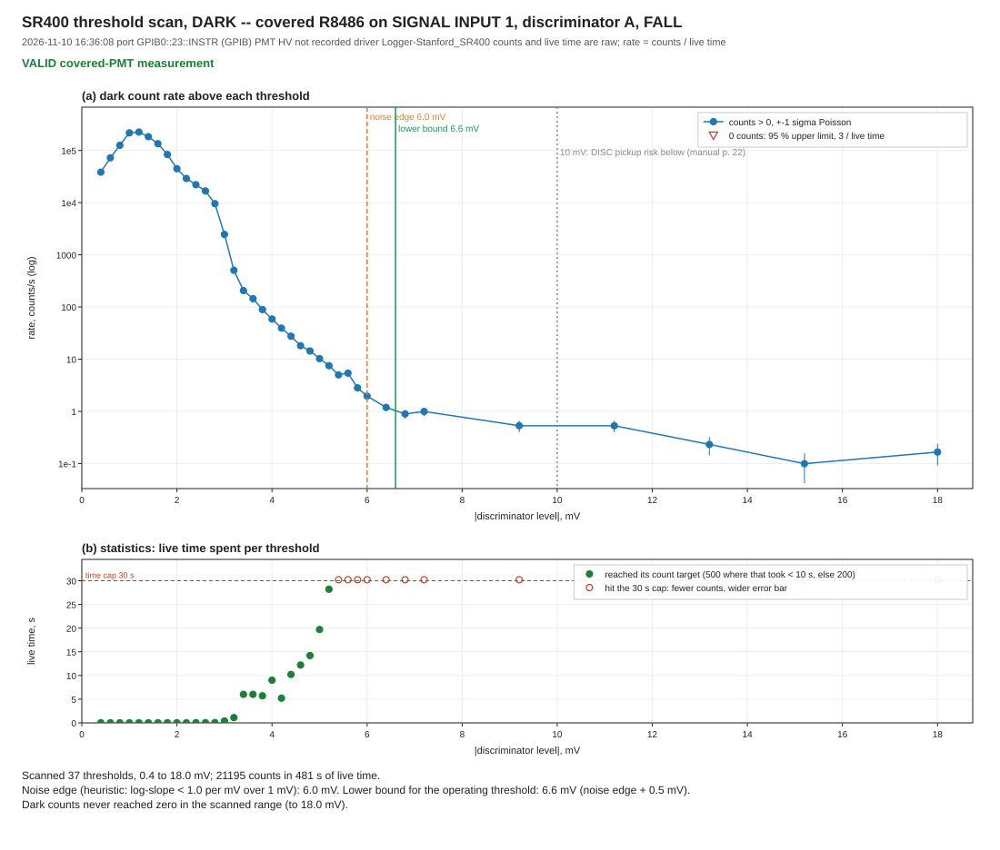
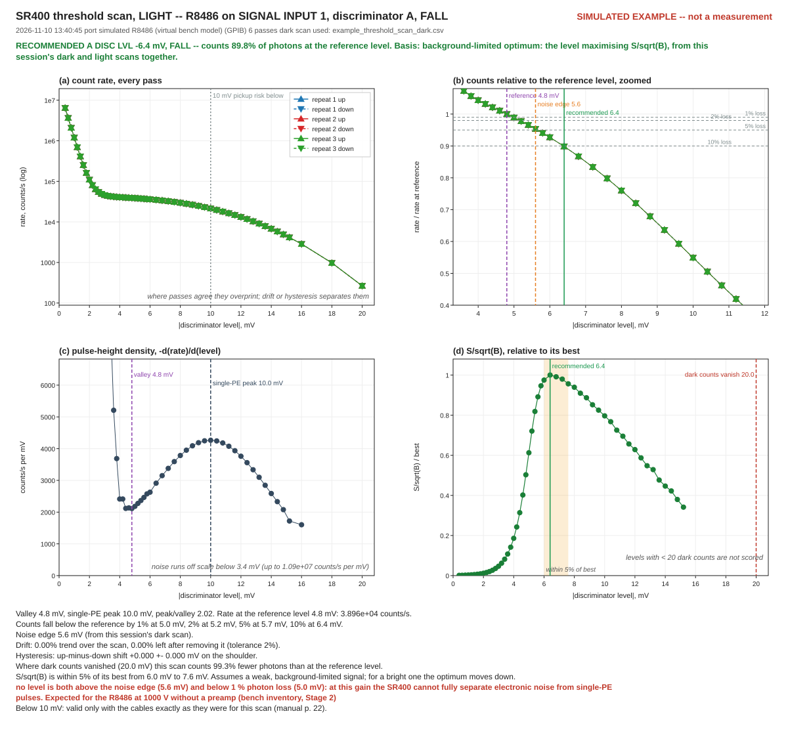
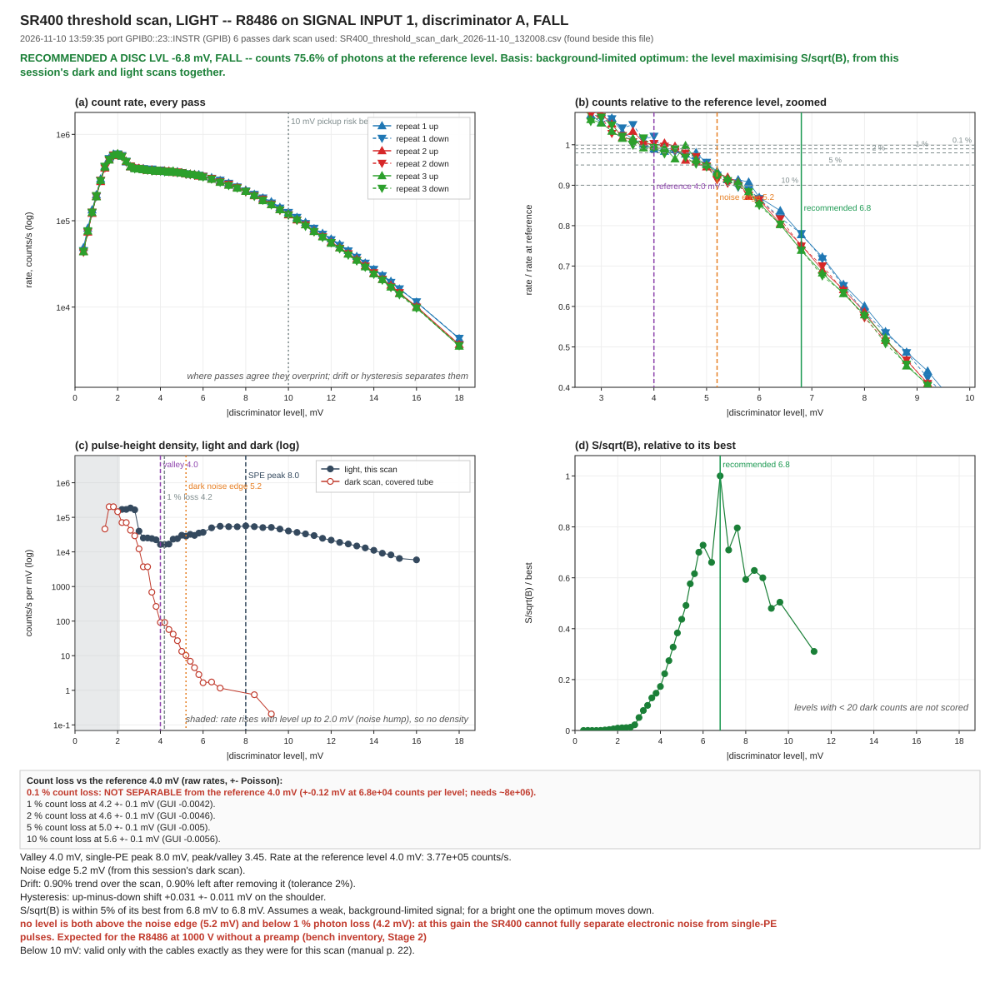
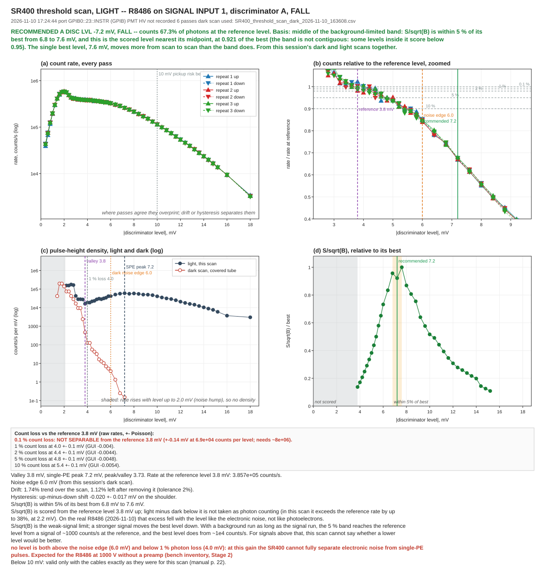

# Simulated versus real threshold scans

The [threshold-scan guide](THRESHOLD_SCAN_GUIDE.md) is illustrated with figures from the driver's
**simulated** R8486 ([`images/`](images/)). This page sets each of those figures beside the **real
scans** of the tube: two runs, each a dark and a light scan, taken on the afternoon of 2026-11-10
([`real_data/2026-11-10/`](real_data/2026-11-10/)). It goes panel by panel, says what the
simulator gets right and wrong, and says what each difference means when you read your own
figure. The figures shown side by side are the first run's; the second run's are below them, and
its numbers are in the tables.

Every number below is computed by the driver's current analysis from the raw CSVs, not read off
a figure. Every figure is regenerated from its CSV by `selftest.py plot`, and the test bench
checks that a committed figure is what the code draws.

**Conditions of the real scans.** R8486 on SIGNAL INPUT 1, discriminator A, slope FALL; SR400 over
GPIB (NI GPIB-USB-HS); SweepMe! 1.5.7.9. Dark: tube covered. Light: room light, 3.3e5 counts/s at
6 mV in both runs.

| Run | Dark | Light | PMT high voltage |
|---|---|---|---|
| first | 13:20 | 13:59 | **1000 V**, from the operator's account; the scan files do not record it |
| second | 16:36 | 17:24 | **not recorded** (the HV field was left at 0); the bench was set to about 1000 V that day |

The second dark scan was recorded before the dark scan kept its fine steps up to 10 mV, so it
went to 2 mV steps at 7.2 mV.

**The simulated examples predate the dark scan's current sampling rules**, so their sampling
differs from a scan made today. They were recorded before fast thresholds counted to 500, and
before the dark scan stepped 2 mV in its tail and stopped there. The analysis drawn on them is
current.

---

## Dark scan

| Simulated | Real, 2026-11-10 |
|---|---|
|  |  |

The second run's dark scan, 16:36:



### Panel (a): dark count rate above each threshold

| | Simulated | Real, 13:20 | Real, 16:36 |
|---|---|---|---|
| Rate at 0.4 mV | 6.4e6 counts/s, the maximum | 3.9e4 counts/s | 3.8e4 counts/s |
| Shape below 2 mV | falls monotonically from the lowest level | **rises** to a hump, 2.3e5 counts/s at 1.2 mV, then falls | **rises** to a hump, 2.3e5 counts/s at 1.2 mV, then falls |
| Above 1e6 counts/s ("oscillation" shading) | up to 1.0 mV | never reached: no shading | never reached: no shading |
| Rate at 3 / 5 / 6 mV | 3.8e3 / 18.7 / 6.5 counts/s | 741 / 7.9 / 2.4 counts/s | 2.5e3 / 10.2 / 2.0 counts/s |
| Rate at 8 / 10 / 14.8 mV | 4.7 / 3.4 / 0.79 counts/s | 1.6 / 0.36 / 0.17 counts/s | not measured on its 2 mV tail grid: 0.99 at 7.2 mV, 0.53 at 9.2 mV, 0.10 at 15.2 mV |
| Noise edge, lower bound | 5.2 mV, 5.8 mV | 5.2 mV, 5.8 mV (GUI `-0.0058`) | 6.0 mV, 6.6 mV (GUI `-0.0066`) |
| Dark counts vanish (zero in 30 s) | from 20.0 mV | from 32.0 mV | not reached by 18.0 mV, where the scan stopped |

**What differs from the simulator, and what it means** (the first run's numbers; the second run
shows the same hump):

- **The real noise does not keep rising as the threshold drops: it has a hump.** Below about
  1.2 mV the real count rate *falls* as the threshold is lowered. The simulator has no such hump.
  This is what broke the first version of the noise-edge search: it read the rising part as
  "flat" and reported 1.0 mV. That is the lower bound printed in the real scan's own report
  (`SR400_threshold_scan_dark_2026-11-10_132008.txt`, made by the driver as it was then). The
  search now starts at the hump's peak. On a real figure, ignore everything left of the hump.
- **The real tail is about ten times lower than the simulator's above 8 mV**, and it reaches
  zero later. The simulator gives dark pulses the same sizes as single-photon pulses, so its tail
  follows the single-PE spectrum. The real tail falls much faster than that. The inference,
  not yet tested, is that most real dark pulses are smaller than a single photoelectron's. Either
  way, the simulator's dark tail is not a model of this tube. The noise edge coincides at 5.2 mV in both,
  but treat that as a coincidence, not a validation.
- **Both put the lower bound at 5.8 mV.** In the real scan the roll-off has two slopes: steep
  (3.9–4.8 per mV in log-rate) from 2.0 to 2.8 mV, then 1.2–2.2 per mV from 3.2 to 5.0 mV, before
  the dark tail flattens to 0.3–0.7 per mV. The "flat" limit of 1.0 per mV was chosen from this scan.
  It is provisional until more scans confirm it.

**The two real dark scans differ.** The second reads higher from 3 to 5 mV (2.5e3 against
741 counts/s at 3 mV, 10.2 against 7.9 at 5 mV) and lower from 6 mV up (2.0 against 2.4 counts/s at
6 mV), and its noise edge is 0.8 mV higher.

**Method or tube? What a study concluded.** The working hypothesis was that the two scans differ
only in method: the second was sampled under the later rules, on a different grid and with
different count targets. The
[dark-scan method study](../analysis/dark_scan_method/README.md) (2026-11-11) tested that. It ran the driver's own sampling and
analysis code on a virtual bench, against simulated tubes tuned to each real scan, 300–400
simulated pairs of scans per case. Its verdict is that **method explains the optimum, not the
curves**:

- **The optimum** moving from 6.8 to 7.6 mV happens by method alone in 13–38 % of simulated pairs
  on one unchanged tube. The top of S/√B is flat, which makes the optimum the output most
  sensitive to method: counting noise alone spreads a single scan's optimum over 6.0–8.4 mV in
  the simulations (standard deviation 0.5–0.7 mV).
- **The differences in the curves** happen by method alone in at most 1 of 300–400 pairs: the
  roll-off at 2.6–3.6 mV (×1.13 to ×3.32), the excess at 4.0–5.6 mV (×1.23), and the tail at
  ×0.59. Two facts from the raw data rule out the obvious method causes. At 2.8 mV both scans
  counted for 0.060 s in all, and got 227 and 573 counts. Both measured 6.0–7.2 mV at 241–335 s
  into the scan, where the second reads 0.67 ± 0.07 of the first, so elapsed time within the scan
  does not explain the tail either.
- **The noise edge** moving from 5.2 to 6.0 mV happens by method alone in 0.25–2 % of pairs.
- **What the study proposes instead is untested:** a change in electronic noise or pickup
  reaching up to about 6 mV, and a dark count rate about 40 % lower later in the day. The HV-on
  time, the cover time and the room temperature were not recorded, so the scans cannot tell.
- **What would settle it:** a dark scan of 2–7 mV with the HV off, or with the anode replaced by a
  50 Ω terminator (an excess that appears without the PMT is pickup); a dark-rate monitor at one
  fixed level, for example 8 mV for 60 s every 10 minutes, from HV-on through a session, with the
  HV-on and cover times written down; and, at 8 mV, the count variance against the window length,
  which separates bursts of dark counts from a varying rate.

These are the study's conclusions from two scans of one tube on one afternoon, not settled
physics.

**What it means when you choose a level.** Because the top of S/√B is flat, the millivolt is
cheap. On the study's simulated tubes a fixed 7.2 mV scores 0.97–0.998 of the best on both, with
either light scan. 7.6 mV scores 0.95–0.97 of the best on the tube like the 13:20 scan, and 6.8 mV
0.96–0.98 on the tube like the 16:36 scan. A single scan's noise edge is also less exact than its
0.2 mV step: in simulated repeats it falls mostly within 5.0–5.6 mV for the 13:20-like tube and
5.6–6.4 mV for the 16:36-like one, a spread of about 0.6–0.8 mV.

The study also proposes four changes to the driver, which are under consideration and **not
made**: letting the background fit narrow only below about 6 mV, 0.2 mV light-scan steps over
6–10 mV, optional alternating dark passes over 5.6–10 mV to pin the optimum to 0.2 mV, and
logging every count period.

### Panel (b): live time per threshold

| | Simulated | Real, 13:20 | Real, 16:36 |
|---|---|---|---|
| Thresholds, range | 57, 0.4–24 mV | 63, 0.4–36 mV | 37, 0.4–18 mV |
| Live time | 16.7 min | 21.1 min | 8.0 min |
| At the 30 s cap | 29 thresholds | 39 thresholds, 93 % of the time, from 5.2 mV up | 12 thresholds, 75 % of the time, from 5.4 mV up |

The real scan spent most of its time on a tail of 0–3 counts per threshold, which sets no bound.
That is why the dark scan now steps 2 mV once the rate is below 1 counts/s at two thresholds in
a row, and stops once three in a row are below 0.5 counts/s. Neither may start below 10 mV, so
the region where the best level lies keeps its 0.2 and 0.4 mV steps. Replayed on these rates, the
current rules stop at 14.0 mV after 10.1 min, against 36 mV after 21.1; the 10 mV floor does not
change this scan. The second scan ran under the 2 mV and stop rules but before the floor, and went
coarse at 7.2 mV, leaving 5 thresholds between 6 and 10 mV. Replayed on its rates with the floor,
it has 11 there, for 10.8 min instead of 7.8. The cost is the "dark counts vanish" level, which is no longer measured. The
report already said not to operate there.

---

## Light scan

| Simulated | Real, 2026-11-10 |
|---|---|
|  |  |

The second run's light scan, 17:24, scored against the 16:36 dark scan:



The real light scan was **recorded without its dark scan**: the dark result was held only in
memory and was lost when SweepMe! restarted. Its own report
(`SR400_threshold_scan_light_2026-11-10_135935.txt`) therefore recommends the valley, 4.0 mV. The
figure above was regenerated with the dark scan found beside it, which is what the driver now
does on its own. The second light scan did exactly that at the time: it found the 16:36 dark scan
on disk, and its CSV names it.

### Panel (a): count rate, every pass

| | Simulated | Real, 13:59 | Real, 17:24 |
|---|---|---|---|
| Rate at 0.4 mV | 6.4e6 counts/s, the maximum | 4.5e4 counts/s | 4.3e4 counts/s |
| Maximum | at 0.4 mV | 5.9e5 counts/s at 2.0 mV (the noise hump again) | 5.8e5 counts/s at 2.0 mV |
| Rate at the reference level | 3.9e4 counts/s at 4.8 mV | 3.8e5 counts/s at 4.0 mV | 3.9e5 counts/s at 3.8 mV |
| Drift over the scan | 0 % (not modelled) | 0.90 %, within the 2 % tolerance | 1.74 %, within the 2 % tolerance |
| Hysteresis, up minus down | 0 (not modelled) | +0.031 ± 0.011 mV, not flagged | −0.020 ± 0.017 mV, not flagged |

The real light was about ten times brighter than the simulated one, in both runs, and above the
2e5 counts/s warning. At the SR400's 5 ns pulse-pair resolution that costs about 0.2 % of counts, which is
below the scan's ±0.5 % resolution. It is still better to dim the source next time.

### Panel (b): counts relative to the reference level

| Count loss vs the reference | Simulated (reference 4.8 mV) | Real, 13:59 (reference 4.0 mV) | Real, 17:24 (reference 3.8 mV) |
|---|---|---|---|
| 0.1 % | not separable (±0.09 mV) | not separable (±0.12 mV) | not separable (±0.14 mV) |
| 1 % | 5.0 ± 0.1 mV | 4.2 ± 0.1 mV (GUI `-0.0042`) | 4.0 ± 0.1 mV (GUI `-0.004`) |
| 2 % | 5.2 ± 0.1 mV | 4.6 ± 0.1 mV | 4.4 ± 0.1 mV |
| 5 % | 5.6 ± 0.1 mV | 5.0 ± 0.1 mV | 4.8 ± 0.1 mV |
| 10 % | 6.4 ± 0.1 mV | 5.6 ± 0.1 mV | 5.4 ± 0.1 mV |

The two curves have the same shape: neither has a flat plateau above the valley. The real curve
falls by about 1 % per 0.2 mV discriminator step from the start.

**Why 0.1 % is refused in both.** A count loss is the difference between two Poisson rates. With
about 7e4 counts per level, as in all three scans, that difference is uncertain by ±0.5 %, so a 0.1 %
loss cannot be told apart from the reference. Separating it needs about 8e6 counts per level,
about a hundred times what this scan collected per level over its six passes. The figure says this instead of
printing a level.

### Panel (c): pulse-height density, light and dark

| | Simulated | Real, 13:59 | Real, 17:24 |
|---|---|---|---|
| Valley | 4.8 mV | 4.0 mV | 3.8 mV |
| Single-PE peak | 10.0 mV | 8.0 mV | 7.2 mV |
| Peak / valley | 2.0 | 3.45 | 3.73 |
| Density ≤ 0 (rate rising with level) | nowhere | 0.4–2.0 mV, shaded | 0.4–2.0 mV, shaded |

The real tube separates single photons from noise **better** than the simulator assumes: its
valley is deeper relative to its peak. Both its valley and its peak sit lower in voltage.

Panel (c) now plots the **dark** scan's density alongside the light, on a log axis, because the
light density is about 1e4 times the dark. In the real figure the dark density falls to about
1 count/s per mV by 6 mV, where the light's is 3.7e4: more than four decades apart. The region where the light rate rises
with the level has no meaning as a density, so it is shaded and named rather than drawn. The
count-loss levels, with their uncertainties and GUI values, are in the box under the panel.

### Panel (d): S/√B, relative to its best

| | Simulated | Real, 13:20 + 13:59 | Real, 16:36 + 17:24 |
|---|---|---|---|
| Optimum | 6.4 mV | 6.8 mV (GUI `-0.0068`) | 7.6 mV (GUI `-0.0076`) |
| Within 5 % of the best | 6.0–7.6 mV | 6.4–7.6 mV | 6.8–7.6 mV |
| Photons counted at the optimum, vs the reference | 90 % | 76 % | 62 % |
| Below the reference, light minus dark exceeds the reference rate by up to | 21 %, at 0.6 mV | 41 %, at 2.2 mV | 38 %, at 2.2 mV |
| Band reaches the valley from a signal of | ~250 counts/s | ~630 counts/s | ~1000 counts/s |
| Best level reaches the valley from | ~2000 counts/s | ~5000 counts/s | ~1e4 counts/s |

Pairing each dark scan with each light scan, the optimum goes with the dark scan: 6.8 mV with the
13:20 one and 7.6 mV with the 16:36 one, whichever light scan it is scored with.

| Dark × light | Optimum | Within 5 % of the best |
|---|---|---|
| 13:20 × 13:59 | 6.8 mV | 6.4–7.6 mV |
| 13:20 × 17:24 | 6.8 mV | 6.4–6.8 mV |
| 16:36 × 13:59 | 7.6 mV | 7.6 mV only |
| 16:36 × 17:24 | 7.6 mV | 6.8–7.6 mV |

What signal rate each level suits, across all four pairings, is in
[`../analysis/low_signal_threshold/`](../analysis/low_signal_threshold/README.md).

**B is a fitted dark background, not each threshold's own count.** Above about 6 mV the real
dark rate is 1–2 counts/s, so a 30 s threshold holds only 30–60 dark counts, and √B taken level by
level would be uncertain by 13–18 %, far more than the 5 % band. Scored that way, the first
run's band shrank to the single level 6.8 mV. B is now a local Poisson fit to the dark scan around each level:
a straight line in log(rate) over ±1 mV in the thin tail, and a narrower quadratic where the
curve bends and the counts allow it. With it the first run's band is 6.4–7.6 mV around the same
6.8 mV optimum. The fit's settings are provisional, chosen on the two real dark scans of
2026-11-10.

**The grey "not scored" region** in every figure is each level below the reference: 4.8 mV
simulated, 4.0 and 3.8 mV real. Below it the real light scans count more than the dark scans by up
to 38–41 % of the reference rate, at 2.2 mV. That excess falls with the level like the electronic
noise, not like photon pulses, so it is not scored as signal.

**This optimum assumes a weak, background-limited signal.** A stronger signal moves the best level
down, towards the valley. With a background run as long as the signal run, the rates from which
the band and the best level reach the valley are in the table above. Above those rates the scan
cannot say whether a level below the valley would be better, and the figure says so. The room
light of these scans, 3.8–3.9e5 counts/s at the valley, is far above all of them.

---

## Regenerating

From the repository root:

```bash
python Logger-Stanford_SR400/selftest.py plot docs/real_data/2026-11-10/SR400_threshold_scan_dark_2026-11-10_132008.csv docs/real_data/2026-11-10/SR400_threshold_scan_light_2026-11-10_135935.csv
```

```bash
python Logger-Stanford_SR400/selftest.py plot docs/real_data/2026-11-10/SR400_threshold_scan_dark_2026-11-10_163608.csv docs/real_data/2026-11-10/SR400_threshold_scan_light_2026-11-10_172444.csv
```

```bash
python Logger-Stanford_SR400/selftest.py plot docs/images/example_threshold_scan_dark.csv docs/images/example_threshold_scan_light.csv
```

Each command plots the dark scan first. The light plot then finds the dark scan: from its own
CSV header, or failing that from the newest dark CSV for the same port beside it.
