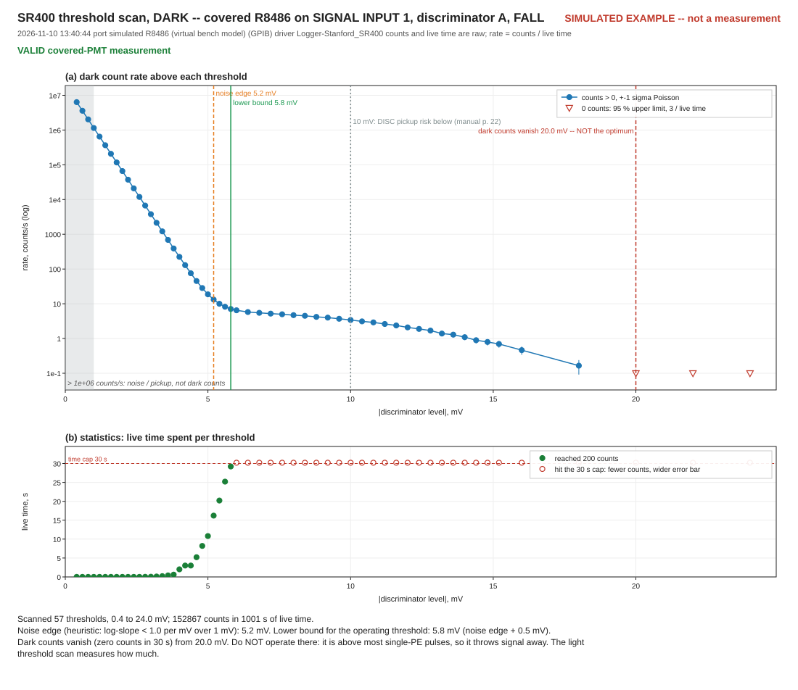
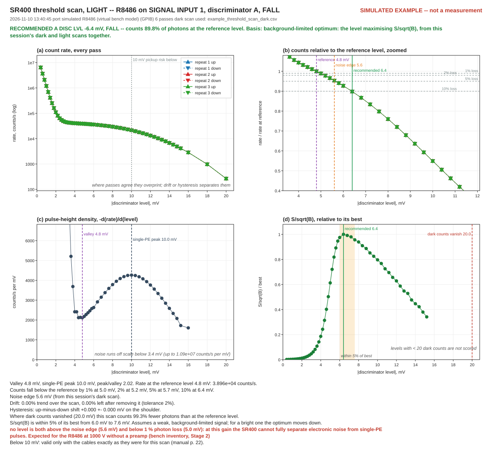

# Choosing the discriminator threshold — a step-by-step guide

For the **R8486 photomultiplier on SIGNAL INPUT 1** of the SR400. You need to know what the
discriminator threshold *is*: the smallest pulse the SR400 will count. This guide covers how to
choose it, using the driver's two threshold scans.

The technical reference is §9.7 of [REFERENCE.md](REFERENCE.md). You don't need it to follow
this.

---

## 1. What you are looking for

Every pulse coming out of the PMT is a different size. Most are single photons, which for this
tube at 1000 V average about **10 mV**, and some are much smaller. Mixed in with them is
**electronic noise**: lots of tiny pulses, mostly under a few mV, that are not photons at all.

The threshold decides which of these get counted:

- **Too low** and you count the noise. Your background goes up, sometimes by orders of magnitude.
- **Too high** and you throw away real photons. Your signal goes down, silently.

There is no level that is perfect at both, so you are looking for the best compromise. It usually
sits just above the point where the noise dies away.

**The trap this guide exists to stop.** The tempting choice is "raise the threshold until the dark
counts go to zero". It is wrong. Dark counts from a PMT are mostly real single-photoelectron pulses
(thermal electrons from the photocathode). They are the same size as your signal photons, so any
level that removes them removes your signal too. Somewhere near the noise edge is right. Zero dark
counts is not.

## 2. Why there are two scans

| Scan | Light on the PMT | What it finds |
|---|---|---|
| **Dark** — `Dark threshold scan (PMT covered)` | none: PMT covered | where the noise stops, i.e. the **lowest** sensible level |
| **Light** — `Light threshold scan (steady light)` | gentle and steady | where you start losing real photons, i.e. the **highest** sensible level |

Run the **dark scan first**, then the light scan. The light scan uses the dark scan's result
to compute the best level, so together they give one recommended number. The dark result is kept
for the port it was measured on for as long as SweepMe! stays open, so run the light scan before
closing SweepMe!, on the same port.

Neither scan changes your settings. Each one restores every setting it touched when it finishes.
The recommended level is **advice for you to enter**, not something the scan applies.

---

## 3. Before you start

- [ ] **SweepMe!** (tested on 1.5.7.9) with the driver installed: the `Logger-Stanford_SR400` folder is in
      `C:\Users\Public\Documents\SweepMe!\CustomDevices\`.
- [ ] A **Logger** module with the SR400 selected, and the port chosen (GPIB address or COM port).
- [ ] You know where the **End-of-run tests** checkboxes are in that module. Each scan below is
      run by ticking its checkbox and starting a short run (one point is enough). The scan runs
      when the run's measurement is done. This is because on SweepMe! 1.5.7.9 the action buttons
      cannot reach the instrument. **Untick the scan when it is done**, or it runs again at the
      end of the next run.
- [ ] The PMT **anode cable on SIGNAL INPUT 1**, with no attenuator.
- [ ] **No other cable** on the SR400's DISC outputs or SIGNAL INPUT 2 (remove any self-test
      loopback cable).
- [ ] The INPUT 1 cable **routed away from the DISC output connectors**. The SR400 manual warns
      that below 10 mV the DISC output pulses can be picked up by the signal cable, which makes
      the discriminator count itself. This tube's best threshold is likely below 10 mV, so this
      matters. Once the scans are done, **don't move the cables**.
- [ ] PMT **high voltage on** at its normal value (1000 V for the R8486), and left on for a few
      minutes so the dark rate settles.
- [ ] The SR400 **not counting from its own front panel** (press STOP on it if in doubt). The
      scans refuse to start while it is counting.

> **Safety.** Never expose the PMT to room light while the high voltage is on. It can damage the
> tube. Turn the HV off before uncovering it, or use only the gentle light described in step 5.

---

## 4. Step 1 — the dark scan

1. **Cover the PMT** completely. No light at all.
2. In the Logger module, tick **`Dark threshold scan (PMT covered)`** (and nothing else under
   End-of-run tests), then start a short run. The scan starts after the run's last point.
3. A message appears: *"Cover the R8486 and make sure NO light can reach it…"*. Check, then
   press **OK**.
4. Wait. The first real scan took **21 minutes**; with the current rules the same tube takes
   **10–11 minutes**, ending near 14 mV. A covered R8486 gives only a few counts per second, so
   each threshold above the noise needs up to 30 s to collect enough counts to be meaningful. From
   10 mV up, once the rate stays below 1 count per second, the scan steps 2 mV at a time, and it
   stops once three thresholds in a row are below 0.5 counts per second, because the tail beyond
   sets no bound. Below 10 mV it keeps its fine steps however quiet the tube is: that is where the
   best level lies, and where the light scan needs the dark rate measured closely. **SweepMe!'s
   debug log shows one line per threshold**, with the time elapsed and an upper bound on the time
   left. **Don't touch the bench or uncover the PMT.**
5. A final message gives a one-line result, for example *"lower bound 5.8 mV (GUI -0.0058)"*,
   and the paths of three files.

### Reading the dark result

Open the **`.svg`** file. It opens in any web browser (double-click, or drag it onto a browser
window).

Here is what a good dark result looks like. **It is a simulated example** — the red note at its
top right says so — made by the driver's own test bench, so your tube's numbers will be different.
What matters is the shape. A **real** scan of the same tube differs in ways worth knowing before
you read your own, above all a noise hump at the far left. See
[SIMULATED_VS_REAL.md](SIMULATED_VS_REAL.md) for the two side by side, panel by panel.



**Panel (a)** is the count rate at each threshold. The vertical axis is logarithmic, so each
gridline is ten times the one below. Reading from left to right:

1. **A steep fall** from millions of counts per second. That's electronic noise. The grey
   shaded strip at the far left marks where it's so high it can't be dark counts at all.
2. **An elbow**, marked by the orange dashed line, **noise edge**. This is where the noise has
   died away.
3. **A long gentle slope** at a few counts per second. These are the real dark counts.
4. **Red hollow triangles** at the right: thresholds where nothing was counted in 30 s. These
   are drawn as "less than" limits, not as zero, because a short wait can't prove zero.

The green line, **lower bound**, sits just above the noise edge. **Don't go below it.** A scan
that runs until the dark counts stop entirely also shows a red dashed line, **dark counts
vanish**, labelled *NOT the optimum* — that's the trap from §1. The example above ran that far.
Today's scan stops earlier, in the tail, so your figure will usually not have this line.

**Panel (b)** shows how long each threshold took. Green dots reached their count target. Hollow
red ones hit the 30 s limit, so they have fewer counts and wider error bars. Seeing lots of red
on the right is normal.

**If the top of the figure says INVALID in red,** the scan doesn't give a lower bound. The
message says why:

| It says | It means | Do this |
|---|---|---|
| *Light is reaching the tube* | far too many counts for a covered PMT | check the cover for leaks, and that the HV is at its normal value; run it again |
| *nothing is reaching SIGNAL INPUT 1* | no counts at all, not even noise | check the PMT cable is on INPUT 1 and the HV is on |

---

## 5. Step 2 — the light scan

Do this **after the dark scan, on the same port**. The light scan uses the dark scan to score
each level. If SweepMe! has been restarted since the dark scan, the light scan reads the newest
dark scan for that port from the results folder (§8). Its report says which file it used and how
old it is.

1. **Set up a gentle, steady light** on the PMT. A dim, stable source, well attenuated. Aim for
   roughly **10,000 to 100,000 counts per second**. If you don't know what your source gives,
   just try it. The scan measures the light level first and tells you if it's wrong (step 3).
2. Untick the dark scan, tick **`Light threshold scan (steady light)`**, and start a short run.
   After the run's last point a message appears: *"Ensure gentle, STEADY light on the
   R8486…"*. Press **OK**.
3. The scan first **checks the light level**. It stops immediately, with nothing else changed,
   if the light is:
   - **too dim** (*"no usable light"*): there's not enough light to see the effect. Increase it a
     little and run it again.
   - **too bright** (*"too bright"*): above about a million counts per second the SR400 starts
     missing pulses, which distorts the result. Reduce it and run it again.
4. If the light level is fine, the scan sweeps the threshold **up and down three times**, six
   passes in all. This takes **about 5 minutes at ~40,000 counts per second**, and longer when the
   light is dimmer. **Keep the light exactly as it is until it finishes.** Comparing the passes is
   how the scan detects whether the light or the discriminator drifted.
5. The final message gives the recommendation, for example *"recommended A DISC LVL −6.4 mV,
   counting 90 % of photons…"*.

### Reading the light result


And a good light result, from the same simulated tube, scored against the dark example above.
Again, the numbers are the simulator's, not your tube's:



Open your light scan's **`.svg`**. The top line, in green, states the recommended level and how it
was chosen. Then four panels:

**(a) Every pass.** All six passes plotted on top of each other. **They should overlap so
closely that they look like one line.** If they visibly fan apart, the light changed during the
scan. The figure will then say NO RECOMMENDATION, and you should steady the source and repeat.

**(b) Zoomed in.** The same data scaled so that the count rate at the *reference level* (the
purple line, normally the valley from panel (c)) is 1.0. The curve drops as the threshold rises,
because it is cutting into real photon pulses. The grey dashed lines mark 0.1 %, 1 %,
2 %, 5 % and 10 % loss. The green line is the recommended level. Where it crosses the curve
tells you what fraction of photons you keep.

**(c) Pulse sizes, light and dark.** This shows how many pulses there are of each size, on a
logarithmic axis, for the light scan (filled dots) and the dark scan (hollow red dots). Look for a
**dip** (purple line, *valley*) followed by a **hump** (*SPE peak*, the single-photoelectron
peak, near 10 mV in the example). The hump is your single photons, and the dip is the gap between
noise and photons. The red dark curve shows how far below the light the background is at each
level. A **grey shaded strip** at the far left marks levels where the rate *rises* with the
threshold, a noise hump that real tubes have. There, a pulse size has no meaning. If there's no
hump in the light curve, the noise and the photons overlap at this gain. The figure will say so,
and that's a sign the tube needs a preamplifier.

**The box under panel (c)** lists the level at each count loss, 0.1 % to 10 %, each with its
uncertainty and the exact value to type into the GUI. A loss too small for the scan to measure is
marked **NOT SEPARABLE**, with the number of counts it would need. With a typical light scan
that is the case for 0.1 %.

**(d) Signal against background.** This is how the recommendation is made. It combines the two
scans into one score, signal divided by the square root of background (S/√B), for every
threshold. It rises as the noise is cut away, peaks, then falls slowly as photons are lost.

- The **shaded band** is every level within 5 % of the best. Anything in it is a good choice.
- The **green line** is the best one: the recommendation.
- A **grey region** at the left, labelled *not scored*, covers every level below the reference
  level (the valley). The scan does not score those levels. Below the valley the light scan counts
  more than the dark scan does, by up to about 40 % on the real tube, but that extra falls with the
  level the way the electronic noise does, not the way photon pulses do. It is extra noise counted
  while the light is on, not more photons, so a score there would be misleading. If the best level
  is **at** the edge of the grey region, the figure says so in red, because a lower level might
  then score higher and the scan cannot tell.
- A **red dashed line** far to the right, when the dark scan went far enough to find it, is
  where the dark counts vanished. The curve there is well below its peak, which is the proof that
  zero dark counts is not the optimum.

If panel (d) says **NOT SHOWN**, the light scan couldn't find a dark scan for that port, either
in memory or in the results folder. Its recommendation then comes from panel (c) alone. Run the
dark scan on the same port, then the light scan again. To redraw an existing light figure with
panel (d), put the two CSV files in one folder and regenerate the plot (see §8). The plot finds
the dark CSV beside the light one.

---

## 6. Choosing and setting the threshold

**The scans' recommendation is the best level for a *weak* signal**, one comparable to or smaller
than the dark counts. A stronger signal is better served by a lower level, which keeps more
photons: once the signal outweighs the dark counts, losing photons costs more than counting a
little more background. So choose from your **signal rate N**, with the table below.

> **Provisional.** The table comes from the four real scans of this R8486 at about 1000 V on
> 2026-11-10 (two dark, two light), analysed in [`analysis/low_signal_threshold/`](../analysis/low_signal_threshold/README.md). The two
> dark scans disagree by more than counting noise, so the low-N rows may still move. **Every level
> here is below 10 mV**, so it holds only with the cables routed as they were for the scans
> (§3). After you change the high voltage, the cables or the tube, repeat the scans (§7): the table
> is this tube's, on that day.

### Your signal rate N

N is your signal's count rate, in counts per second, **with the dark counts subtracted and the
discriminator at the valley** (the purple *valley* line in panel (c), about 4 mV on this tube).
You need it only roughly, because each row of the table covers a range. To estimate it, count
with the signal on and then off at 6.8 mV (`-0.0068`), subtract the two rates, and divide by
0.75: about 75 % of the photons counted at the valley are counted at 6.8 mV on this tube.

### The table

For the usual measurement: **a signal-on run and a signal-off run of the same length**, the
difference being your signal.

| Signal N (counts/s at the valley) | Set | Type in the GUI | Also fine (within 5 %) | Each run, for 10 % precision on N |
|---:|---:|---:|---|---:|
| 1     | 6.8 mV | `-0.0068` | 6.8 mV only | 500–730 s |
| 2     | 6.8 mV | `-0.0068` | 6.8 mV only | 160–220 s |
| 5     | 6.8 mV | `-0.0068` | 6.4–6.8 mV | 41–51 s |
| 10    | 6.4 mV | `-0.0064` | 6.0–6.8 mV | 17–19 s |
| 20    | 6.0 mV | `-0.0060` | 5.6–6.8 mV | 7.4–7.7 s |
| 50    | 5.8 mV | `-0.0058` | 5.4–6.4 mV | 2.6 s |
| 100   | 5.6 mV | `-0.0056` | 5.0–6.4 mV | 1.2 s |
| 200   | 5.6 mV | `-0.0056` | 4.6–6.0 mV | 0.58 s |
| 500   | 5.0 mV | `-0.0050` | 4.2–6.0 mV | 0.22 s |
| 1000  | 4.6 mV | `-0.0046` | 4.0\*–5.8 mV | 0.11 s |
| 10000 | 4.0 mV\* | `-0.0040` | 4.0\*–5.6 mV | 0.010 s |

- **"Set"** is the one level that does best across all four dark × light pairings of the real
  scans. **"Also fine"** is every level within 5 % of the best in all four: anything in it costs
  at most about 11 % more counting time.
- **The time** is the length of *each* run (signal on, signal off), so the clock time is twice
  that. The range covers the four pairings. For a precision p other than 10 %, multiply by
  (0.1/p)².
- \* **4.0 mV is the valley, the lowest level the scans can score** (the grey *not scored*
  region of panel (d), §5). From N ≈ 300–600 counts/s the lower edge of the "also fine" range,
  and from N ≈ 2000–4500 the best level itself, may lie below it, and the scans cannot tell. Your
  own light scan's report gives the same limits for your tube, as the signal rate from which the
  5 % band and the best level reach the valley.

**If you want one setting and don't know N well:**

| N somewhere between | Set | Costs at most, in counting time |
|---|---:|---:|
| 1 and 10    | **6.8 mV** (`-0.0068`) | 4 % |
| 1 and 100   | **6.8 mV** (`-0.0068`) | 17 % |
| 1 and 10000 | **6.4 mV** (`-0.0064`) | 25 % |
| 100 and 10000 | **5.0 mV** (`-0.0050`) | 6 % |

**If your signal-off run is much longer than the signal run**, so that the background is known
precisely, the best levels are 0–0.6 mV lower than in the table. That table is in the
[analysis README](../analysis/low_signal_threshold/README.md).

### If your signal brings its own photon background

Sometimes the light you measure brings stray light, scatter or fluorescence along with it, a
fraction **f** of the signal. It has the same pulse sizes, so no threshold can separate it, and it
is absent from the signal-off run. You correct for it with an assumed f. Then:

1. **Set the threshold as if there were no photon background, for a signal of N × (1 + f).** For
   f up to 10 % that is the same row of the table, except right at a step between rows (at
   N = 200 the level drops from 5.6 to 5.0 mV between f = 1 % and 3 %, a near-tie). At f = 50 %
   it is at most 0.6 mV lower.
2. **An uncertainty in f sets a floor on your accuracy that no threshold and no counting time
   lowers.** An uncertainty Δf on f biases N by about Δf / (1 + f), at every level. For example,
   f = 10 % ± 3 % gives a floor of 2.7 %. At f = 50 % ± 15 % the floor is 10 %, so a total of 10 %
   is never reached, however long you count.

If your counting time is fixed, then once its counting noise is well below that floor the exact
threshold matters less and less. If you count until you reach a target precision instead, it
matters exactly as much as without a photon background. The details, including when the
crossover comes, are in [`analysis/photon_background/`](../analysis/photon_background/README.md).
**Provisional, and a model**: f and Δf are your inputs, and nothing in the scans measures them.

### Setting it

Enter the level in the SweepMe! Logger module's GUI:

| Field | Enter | Example |
|---|---|---|
| `Discriminator A slope` | `Fall` | `Fall` |
| `Discriminator A level in V` | your chosen level, **negative**, **in volts** | −6.4 mV → **`-0.0064`** |
| `Counter A input` | `INPUT 1` | `INPUT 1` |

> **Watch the units.** The field is in **volts**, and the scans report **millivolts**. −6.4 mV is
> `-0.0064`, not `-6.4`. The level is negative because the PMT's pulses are negative. The SR400
> accepts levels in 0.2 mV steps, and every level the scans recommend is already one of them.

The level is sent to the SR400 when the measurement starts.

### Messages you might see in the recommendation

- **"strict window empty — preamp would help."** No level is both fully clear of the noise and
  keeps 99 % of the photons. That's expected for this tube at 1000 V without a preamplifier. The
  recommendation is still the best available compromise, and the figure tells you what fraction
  of photons it keeps.
- **"hysteresis"** (marked as a failed check). The discriminator's real level depends slightly on
  whether you approached it from above or below. When you set the level, always come from the
  same direction, or allow the margin the report gives.
- **"AT the reference level, the lowest level scored"** (in red). The best S/√B is at the
  valley, the edge of the grey *not scored* region. A lower level might be better, and the scans
  cannot tell. Use the valley level, and see the footnote to the table above.
- **"below 10 mV: valid only with the cables exactly as they were".** Because of the pickup
  effect in §3. If you move the cables, repeat the scans.

---

## 7. When to repeat the scans

Repeat both scans, dark then light, after you:

- change the PMT **high voltage**: pulse sizes scale with it, so the best level moves;
- **move or replace cables** near the SR400's inputs or DISC outputs;
- change the PMT, or add an amplifier or attenuator;

and occasionally anyway, for example monthly, as a check that nothing has changed.

---

## 8. Where the results are

Each scan writes three files with the same name into

```
C:\Users\Public\Documents\SweepMe!\DataDevices\Logger-Stanford_SR400\
```

| File | What it is |
|---|---|
| `SR400_threshold_scan_dark_<date_time>.txt` | the report, with every number |
| `SR400_threshold_scan_dark_<date_time>.csv` | the raw measurements |
| `SR400_threshold_scan_dark_<date_time>.svg` | the figure, which opens in any web browser |

and the same three for the light scan. The final message of each scan gives the exact paths.

The same folder also holds **`SR400_test_log.csv`**, with one row per scan or self-test, ever.
It is the quickest place to find a past result: the light scan's row has the recommended level in
`recommended_disc_A_level_V`, already in volts and signed, ready to type in. The dark scan's row has
the lower bound, and where dark counts vanish if the scan went that far.

**To get help with a result, send all six files.** The CSV files hold the raw data, so anyone can
redraw the figures from them. On a machine with Python, put both CSV files in one folder and run:

```bash
python selftest.py plot SR400_threshold_scan_light_<date_time>.csv
```

`selftest.py` is in the driver folder. This also restores panel (d) if the two scans weren't run
in the same session. The example figures in this guide were made exactly this way, and their CSVs
are beside them in [`images/`](images/) if you want to try it.

---

## 9. If a scan won't start

| Message | Do this |
|---|---|
| *select a port first* | choose the SR400's port in the Logger module |
| *the SR400 is counting* | press STOP on the SR400, then run it again |
| *the SR400 did not answer a status query* | check the instrument is on and connected, and the port and GPIB address are right |
| *the self-test module could not be loaded* | `selftest.py` is missing from the driver folder: copy the whole folder again |

---

## 10. Finding the best PMT high voltage

The threshold depends on the high voltage. More HV means more gain: the single-photon pulses grow
and move away from the electronic noise, so they separate better. At some point the dark counts
start to rise faster than the separation improves. The procedure below runs the scans at several
voltages and lets the driver compare them. The HV is set **by hand**. The driver never sets or
reads it; it only records the value you type in.

**Before you start.** Choose the voltages. 1000 V is probably near the optimum already, so a
fine bracket around it is enough: **975, 1000, 1025, 1050 and 1075 V**. Check the R8486 data
sheet for its maximum rating and stay below it. Keep **the same light source and setting**
throughout.

**Interleave, and repeat.** Visit the voltages in order and then go round again: 975, 1000, …,
1075, then 975, 1000, … once more, two or three rounds in all. A light source that drifts then
shows up as a trend over *time*, which the comparison corrects, rather than as a trend over
*voltage*. The replicates give each voltage an error bar.

**First round: at each voltage, one short run with all three tests.**

1. Set the HV on the supply. Type **the same value** into the Logger module's field
   **`PMT high voltage in V (record only, 0 = not recorded)`**. Every report, CSV and figure then
   carries it.
2. Tick **`Dark settling check (PMT covered)`**, **`Dark threshold scan (PMT covered)`** and
   **`Light threshold scan (steady light)`**, and start a short run (one point).
3. When asked, cover the tube. The **settling check** counts dark pulses at your operating
   threshold until the rate stops changing. It fits a straight line through the last 5 minutes
   and needs the slope to be consistent with zero. This takes at least 5 minutes, and at most 30.
   You don't have to guess a settling time. The debug log shows the drift after every block. The
   dark scan follows straight away.
4. When asked, uncover the tube and set the light. The light scan follows.

**Later rounds: the light scan only.** Set the HV and type it in, tick only
**`Light threshold scan`**, and run. It uses that voltage's dark scan from the first round,
matched by the recorded HV, so the dark work is done once per voltage. Allow the tube a minute
after each HV change before starting. The first round takes about 25 minutes per voltage; later
rounds take about 5 minutes per voltage.

**Then compare.** From the results folder (§8), with the path to `selftest.py` in the driver
folder:

```bash
python "C:/Users/Public/Documents/SweepMe!/CustomDevices/Logger-Stanford_SR400/selftest.py" hv-compare .
```

It writes `SR400_hv_compare_<date_time>.csv`, a
table with one row per voltage, `SR400_hv_compare_<date_time>_replicates.csv` with one row per scan, and an `.svg` figure with five panels:

- **(a) gain:** where the valley and the single-photon peak sit, in mV. Both should rise with HV.
- **(b) peak/valley:** how cleanly photons separate from noise. Higher is better.
- **(c) dark rate at half the single-photon peak:** the background at a threshold that scales with
  the gain, so the voltages are compared fairly.
- **(d) best S/√B** at each voltage: each scan in grey, the mean ± standard error in green. Each
  scan's value is corrected to a common light level using its own measured photon rate, since
  signal scales with the light and background does not.
- **(e) the light level of every scan, in the order taken.** A step or a trend here is the source
  drifting. The correction in (d) removes it; this panel shows it actually happened.

It names an **optimum HV** only when at least three voltages are comparable and the best S/√B
turns over *inside* the range. With replicates it also says whether the winner is **resolved**
from the runner-up. If their gap is under twice its uncertainty, either voltage is as good on the
evidence. It refuses to compare at all only if the light changed by more than 50 % between scans
(a moved source, a different filter), because then proportional correction is in doubt. If the best is at the highest or lowest
voltage scanned, it says so and asks you to extend the range. A voltage whose dark rate had
**not settled** is left out. The line naming the optimum also gives the fraction of photons
counted there. If that is under half, it warns that this optimum suits only a weak signal.

**What the settling check can and cannot see.** At a few counts per second, the check can only
resolve drifts of a few percent per minute in 5 minutes, and its report says exactly how much.
If it reports **CANNOT JUDGE**, there were too few counts at your threshold to fit a drift.
Settling is then unknown, not refuted. These limits are provisional: the first real settling
curve of this tube will show whether they are sensible.
